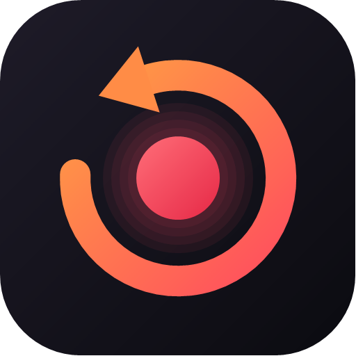

<p align="center">
  
</p>

<h1 align="center">Hindsight</h1>

<p align="center"><b>Oyundaki en iyi anı kaçırma.</b> Arka planda sessizce kaydeden, tek tuşla klip kaydeden hafif Windows uygulaması.</p>

<p align="center">
  <a href="https://hindsight-clips.vercel.app">Web sitesi</a> ·
  <a href="https://github.com/efebalci569-dot/hindsight/releases/latest">İndir</a> ·
  <a href="docs/releases/0.1.0.md">Sürüm notları</a>
</p>

---

## Ne yapar?

- **Anlık tekrar** — Bir oyun açtığında Hindsight son anları arka planda tutmaya başlar. `Alt+F8`'e bastığında son 15 saniye ile 5 dakika arası (sen seçersin) klip olarak kaydedilir. Oyun kapanınca kayıt durur.
- **Oyun kütüphanesi** — Steam, Epic Games, GOG, Ubisoft Connect, EA app, Battle.net, Riot Games, Rockstar ve Xbox / Microsoft Store oyunlarını bulur ve platform platform bölümlere ayırır. Listede olmayan bir oyunu tam ekran oynadığında onu da kendiliğinden ekler.
- **Klipler oyun oyun** — Her oyunun kendi klasörü (`Videolar\Hindsight\<Oyun>`), favoriler, arama ve sıralama. Oynatıcıda kırp, Discord için 10/50 MB'a küçült, GIF yap, panoya kopyala ve Discord'a yapıştır.
- **Senin ayarların** — 480p – 1080p, 30 / 60 FPS, kalite ya da özel bit hızı, H.264 / HEVC / AV1, kodlayıcı seçimi, oyun penceresi ya da tüm ekran, sistem sesi + mikrofon, kısayollar, depolama sınırı.
- **Ekstralar** — Süre sınırı olmayan manuel kayıt (`Alt+F7`), tam çözünürlükte ekran görüntüsü (`Alt+F12`), oyun başına "bu oyunu kaydetme", Hindsight'ın ölçtüğü oynama süresi, oyun içinde odağı çalmayan bildirim, tepside çalışma, Windows ile başlatma.

## Neden hafif?

| | |
|---|---|
| **Görüntü RAM'e inmez** | Ekran, Windows Graphics Capture ile ekran kartında yakalanır, yine ekran kartında 1080p/720p'ye küçültülür ve doğrudan donanım kodlayıcısına (NVENC / AMF / Quick Sync) gider. |
| **Arabellek diskte döner** | Son anlar RAM'de değil, üzerine yazılan 2 saniyelik küçük dosyalarda tutulur. Klip süresini 5 dakikaya çıkarsan da bellek kullanımı değişmez. |
| **Sadece oyun açıkken** | Varsayılan modda kayıt motoru masaüstündeyken hiç çalışmaz. |
| **Tepside neredeyse sıfır** | Pencere kapanınca arayüz tamamen kaldırılır ve bellek Windows'a geri verilir. |
| **Klip anında hazır** | Kaydetme yeniden kodlama yapmaz; parçalar birleştirilir (0,1 sn). |

Ölçümler (RTX 5070, 1920×1080 ekran, Hindsight 0.1.0):

| Durum | RAM | CPU |
|---|---|---|
| Tepside, oyun yok | ~20 MB | ~0 |
| Arka plan kaydı, 720p60 NVENC | kayıt motoru ~130 MB | tek çekirdeğin ~%5'i |
| Arka plan kaydı, 1080p60 NVENC | kayıt motoru ~200 MB | tek çekirdeğin ~%10'u |
| Klip kaydetme | — | 0,7–1,5 sn (o anki 2 sn'lik parçanın bitmesini bekler) |

Ses ve görüntü arasındaki kayma ölçüldü: ~0–50 ms (ayarlardan ince ayar yapılabilir).

## Kurulum

[Son sürümü indir](https://github.com/efebalci569-dot/hindsight/releases/latest) → `HindsightSetup-x.y.z.exe`. Yönetici izni gerekmez.
Uygulama imzasız olduğu için Windows SmartScreen ilk açılışta uyarabilir: **Ek bilgi → Yine de çalıştır**.

Gereksinimler: Windows 10 1903+ veya Windows 11 (64-bit). Ekran kartı kodlayıcısı yoksa Windows Media Foundation ya da işlemci kullanılır.

## Geliştirme

```bash
dotnet build Hindsight.sln
dotnet test Hindsight.sln
```

- `src/Hindsight.Core` — kayıt motoru (ffmpeg + WASAPI ses), oyun tarayıcıları, oyun algılama, klip kütüphanesi
- `src/Hindsight.App` — WPF arayüz, tepsi, global kısayollar
- `tests/Hindsight.Tests` — birim testleri; `HINDSIGHT_INTEGRATION=1` ile gerçek ekran + ses kaydı testi, `HINDSIGHT_SYNC=1` ile ses/görüntü senkron ölçümü
- `site/` — indirme sitesi (Vercel)
- `installer/` — Inno Setup kurulum betiği

Geliştirirken ffmpeg `PATH`'te ya da `C:\ffmpeg\bin` altında aranır; paket için `scripts/fetch-ffmpeg.ps1` ve `scripts/publish.ps1`.
Arayüz önizlemesi (pencere açmadan, kayıt yapmadan): `Hindsight.exe --data-dir <klasör> --capture shot.png --page games`.

Yeni sürüm: `Directory.Build.props` içindeki `Version`'ı artır, `docs/releases/X.Y.Z.md` ekle, `vX.Y.Z` etiketini gönder — GitHub Actions kurulum dosyasını ve zip'i yayınlar.

## Lisans

MIT. Paketlenen FFmpeg ayrı bir program olarak çalışır ve GPL v3 lisanslıdır — bkz. [THIRD-PARTY-NOTICES.md](THIRD-PARTY-NOTICES.md).
